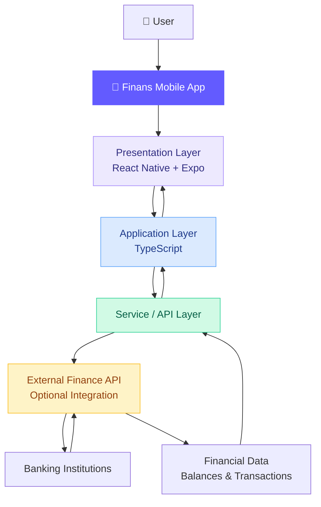

# 💸 Finans — Personal Finance Mobile App

<p align="center">
  
</p>

<h1 align="center">Finans</h1>

<p align="center">
  <b>Your finances. One place. Better decisions.</b>
</p>

<p align="center">
  A modern cross-platform finance application built with React Native, Expo, and TypeScript.
</p>

<p align="center">
  <a href="https://github.com/SauvirWodehra/Finance-React_Native-App">
    
  </a>
  
  
  
</p>

<p align="center">
  <a href="#-features">Features</a> •
  <a href="#-high-level-design-hld">Architecture</a> •
  <a href="#-tech-stack">Tech Stack</a> •
  <a href="#-getting-started">Getting Started</a>
</p>

---

## 📌 Overview

**Finans** is a mobile application focused on making personal finance management simpler and more accessible.

The goal is to provide users with a centralized interface to understand their financial position, explore transactions, and gain insights into their spending habits.

The application is built using React Native and Expo, enabling development for both Android and iOS from a shared TypeScript codebase.

## ✨ Features

- 📊 **Financial Dashboard** — A centralized view of financial information.
- 💰 **Balance Overview** — View and organize account balance information.
- 🧾 **Transaction History** — Review financial transactions.
- 📱 **Cross-Platform Experience** — Support for Android and iOS.
- 🎨 **Modern Mobile UI** — A clean interface inspired by contemporary fintech applications.
- 🧩 **Modular Architecture** — A foundation for adding new screens, services, and integrations.

> Some features may require additional backend services or third-party banking integrations. Refer to the current implementation before treating these capabilities as production-ready.

## 🖼️ App Design

Explore the original design concepts and interactive prototype.

| Resource | Link |
|---|---|
| Figma Design | [Open design](https://www.figma.com/file/OMrKC7nSHrZgWkkyxPCTud/finance-app) |
| Interactive Prototype | [Explore screens](https://www.figma.com/proto/OMrKC7nSHrZgWkkyxPCTud/finance-app?node-id=1325-27&p=f&t=I3pLQ99FTIoRbpOF-1&scaling=scale-down&content-scaling=fixed&page-id=0%3A1&starting-point-node-id=1325%3A27) |

<!-- Add application screenshots here when available.
<p align="center">
  
  
</p>
-->

## 🏗️ High-Level Design (HLD)

Finans follows a mobile-client architecture. The React Native application handles the user interface and interactions, while application services can provide a boundary for financial data and external API communication.

### System Architecture



*The diagram illustrates the intended integration architecture. The service, finance API, and banking connections are architectural extension points, not claims that those integrations are already implemented.*

### Architecture Components

| Component | Responsibility |
|---|---|
| Presentation Layer | Renders screens, navigation, and user interactions. |
| Application Layer | Handles application logic, state, and data transformation. |
| Service / API Layer | Provides a structured boundary for requests and responses. |
| External Finance API | Can retrieve authorized financial information from supported providers. |
| Data Layer | Represents balances, accounts, and transaction records. |

### Data Flow

1. The user opens a screen or performs an action.
2. The presentation layer captures the interaction.
3. The application layer processes the request.
4. When required, the service layer requests financial data from an external API.
5. The returned data is transformed into a suitable application model.
6. The UI updates to display the resulting information.

For a production banking integration, authentication, consent management, secure token handling, and appropriate error handling must also be implemented.

## 🧱 Project Structure

The following structure is based on the repository's visible files. The internal contents of `src` are omitted because they are not shown in the current project overview.

```text
Finance-React_Native-App/
│
├── .expo/                   # Expo development state
├── .github/                 # GitHub assets and workflows
├── .husky/                  # Git hooks
│
├── android/                 # Native Android project
├── ios/                     # Native iOS project
│
├── node_modules/            # Installed dependencies
├── src/                     # Application source code and assets
│
├── .env                     # Local environment variables
├── .env.example             # Environment variable template
├── .eslintignore            # ESLint ignore rules
├── .eslintrc.js             # ESLint configuration
├── .gitattributes           # Git attributes
├── .gitignore               # Git ignore rules
├── .prettierrc.js           # Prettier configuration
│
├── app.config.js            # Expo application configuration
├── App.tsx                  # Application entry component
├── babel.config.js          # Babel configuration
├── metro.config.js          # Metro bundler configuration
├── eas.json                 # Expo Application Services configuration
│
├── package.json             # Dependencies and npm scripts
├── package-lock.json        # Dependency lockfile
├── tsconfig.json            # TypeScript configuration
│
├── CHANGELOG.md             # Project change history
├── CONTRIBUTING.md          # Contribution guidelines
├── LICENSE                  # Project license
└── README.md                # Project documentation
```

## 🛠️ Tech Stack

<p>
  
  
  
  
</p>

- **React Native:** Cross-platform mobile UI development.
- **Expo:** Development tools and native application workflows.
- **TypeScript:** Type-safe application development.
- **Metro:** JavaScript bundling for React Native.
- **Babel:** JavaScript and TypeScript transformation.
- **ESLint:** Code quality and linting.
- **Prettier:** Consistent code formatting.
- **Expo EAS:** Application build and submission configuration.

## 🚀 Getting Started

### Prerequisites

Install the following tools before running the application:

- [Node.js](https://nodejs.org/)
- npm
- [Git](https://git-scm.com/)
- [Expo Go](https://expo.dev/go) or a configured native development environment

### 1. Clone the Repository

```bash
git clone https://github.com/SauvirWodehra/Finance-React_Native-App.git
```

### 2. Navigate to the Project

```bash
cd Finance-React_Native-App
```

### 3. Install Dependencies

```bash
npm install
```

### 4. Configure Environment Variables

The repository includes `.env.example` and `.env`.

If the template contains the required configuration, create your local environment file using:

**Windows PowerShell**

```powershell
Copy-Item .env.example .env
```

**macOS / Linux**

```bash
cp .env.example .env
```

Fill in the necessary values according to the project's configuration. Do not commit secrets or API credentials.

### 5. Start the Application

```bash
npx expo start
```

Then scan the QR code with a compatible Expo Go installation, or launch the application using a configured emulator.

### 6. Run on a Specific Platform

```bash
# Android
npx expo start --android

# iOS
npx expo start --ios

# Web, if supported by the project
npx expo start --web
```

Platform availability depends on your development environment and project configuration.

## 🔒 Security Considerations

Financial applications require special care when handling sensitive data.

- Never expose API secrets in client-side code.
- Keep `.env` out of version control.
- Use HTTPS for network requests.
- Use secure storage for sensitive tokens where appropriate.
- Apply authentication and authorization to protected resources.
- Use authorized banking APIs and explicit user consent.
- Avoid logging credentials, tokens, or sensitive financial information.

**Important:** Environment variables bundled into a mobile client should not be treated as secret storage.

## 🗺️ Roadmap

Potential future enhancements include:

- [ ] Secure authentication and account management.
- [ ] Integration with a supported financial data provider.
- [ ] Account aggregation and balance synchronization.
- [ ] Transaction categorization and search.
- [ ] Spending analytics and interactive charts.
- [ ] Monthly budgets and savings goals.
- [ ] Offline-friendly dashboard and loading states.
- [ ] Unit and integration testing.
- [ ] Automated build and release workflows.

## 🤝 Contributing

Contributions and suggestions are welcome.

1. Fork the repository.
2. Create a feature branch.
3. Make your changes and test them.
4. Commit your changes using a clear commit message.
5. Open a pull request describing the changes.

Please review [CONTRIBUTING.md](CONTRIBUTING.md) before contributing.

## 📄 License

See the [LICENSE](LICENSE) file for the applicable licensing terms.

## 👨‍💻 Developer

**Sauvir Wodehra**

<p>
  <a href="https://github.com/SauvirWodehra">
    
  </a>
  <a href="https://www.linkedin.com/in/sauvir-wodehra-032821257/">
    
  </a>
</p>

---

<p align="center">
  <b>Finans</b> — Making personal finance easier to understand.
</p>

<p align="center">
  If you find this project useful, consider giving it a ⭐ on GitHub.
</p>
